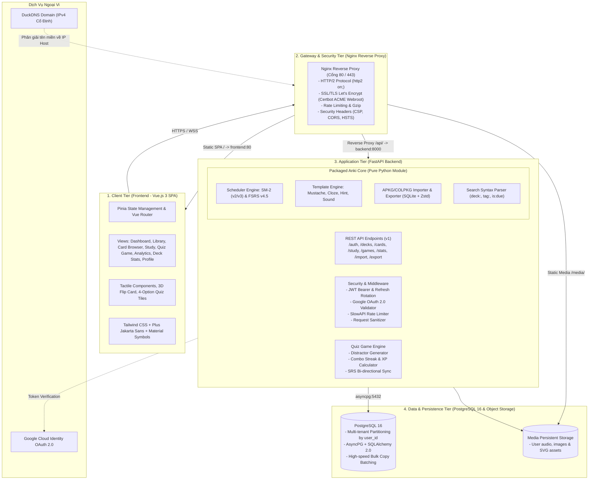

# Kiến Trúc Tổng Thể Hệ Thống (System Architecture)

## 1. Giới thiệu dự án
Dự án là nền tảng Web Flashcard học tập theo phương pháp lặp lại ngắt quãng (Spaced Repetition System - SRS) đa người dùng, tích hợp cơ chế Game hóa (Gamification). Hệ thống kế thừa và đóng gói nguyên bản logic thuật toán từ **Anki** (SM-2 và FSRS), đồng thời tái thiết kế toàn diện giao diện người dùng (UI/UX) theo ngôn ngữ thiết kế hiện đại **Cognitive Flow**, tối ưu cho cả máy tính (Desktop) và thiết bị di động (Mobile).

Hệ thống được thiết kế theo tư duy **Tinh Gọn (Lean Architecture)**:
- **Tối giản hóa dịch vụ nền**: Loại bỏ các container bổ trợ không cần thiết (như container DuckDNS động khi máy chủ đã có IPv4 cố định).
- **Cách ly mạng tuyệt đối (Strict Network Isolation)**: Chỉ duy nhất 2 cổng đối ngoại `80` và `443` được mở ra ngoài internet; toàn bộ giao tiếp giữa CSDL, API Backend và Frontend diễn ra trong mạng bridge ảo khép kín.

---

## 2. Mô hình phân tầng kiến trúc (Clean Multi-Tier Architecture)

---

## 3. Chính Sách Cách Ly Cổng Mạng (Strict Network Isolation Matrix)

Nhằm bảo đảm an toàn thông tin tối đa, toàn bộ các cổng nhạy cảm đều được cô lập bên trong mạng Docker riêng biệt `memora_net`:

| Tên Container | Vai trò | Cổng nội bộ | Ánh xạ ra ngoài Host (Ports) | Cơ chế bảo vệ |
| :--- | :--- | :--- | :--- | :--- |
| `memora_gateway` | Nginx Ingress / Reverse Proxy | 80, 443 | **0.0.0.0:80**, **0.0.0.0:443** | Cổng duy nhất tiếp nhận traffic từ Internet, kiểm soát bằng TLS/SSL |
| `memora_frontend` | Nginx Static Assets Server | 80 | **Không ánh xạ** (`80/tcp` nội bộ) | Chỉ Gateway truy cập được qua hostname `frontend:80` |
| `memora_backend` | FastAPI Application Server | 8000 | **Không ánh xạ** (`8000/tcp` nội bộ) | Chỉ Gateway truy cập được qua hostname `backend:8000` |
| `memora_postgres` | CSDL Quan hệ PostgreSQL 16 | 5432 | **Không ánh xạ** (`5432/tcp` nội bộ) | **Cách ly CSDL 100%**, chỉ Backend kết nối qua `postgres:5432` |

---

## 4. Các thành phần chính của hệ thống

### 4.1. Nền tảng Frontend (Vue.js 3 + TypeScript + Vite)
- **Framework**: Vue 3 (Composition API, `<script setup lang="ts">`).
- **Quản lý trạng thái (State Management)**: Pinia stores (`useAuthStore`, `useDeckStore`, `useStudyStore`, `useQuizStore`, `useStatsStore`).
- **Giao diện & Thẩm mỹ**: Tailwind CSS v3, tích hợp bộ màu `Cognitive Flow`, font chữ *Plus Jakarta Sans*, hệ thống icon *Material Symbols Outlined* trực quan.
- **Danh sách màn hình (Views)**:
  1. `DashboardView` (`/dashboard`): Bento grid thống kê tổng quan ngày, chỉ tiêu ôn tập, streak.
  2. `LibraryView` (`/library`): Quản lý cây thư mục bộ thẻ phân tầng đa cấp.
  3. `CardBrowserView` (`/browse`): Trình duyệt thẻ toàn diện, tìm kiếm toàn văn, lọc theo trạng thái (`new`, `due`, `learning`, `lapsed`, `suspended`), chỉnh sửa nội dung trường và nhãn tags.
  4. `StudyView` (`/study`): Màn hình lật thẻ 3D tunnel vision không xao nhãng kèm phím tắt 1-4.
  5. `QuizGameView` (`/games`): Game trắc nghiệm 4 lựa chọn xúc giác 3D tactile buttons.
  6. `QuizResultView` (`/games/result`): Bảng tổng kết ván chơi, độ chính xác %, XP tích lũy.
  7. `AnalyticsView` (`/analytics`): Phân tích tiến độ học tập và biểu đồ lưu giữ trí nhớ dài hạn.
  8. `DeckStatsView` (`/decks/:id/stats`): Thống kê chuyên sâu từng bộ thẻ (Hizashi metrics & ma trận 5 cấp độ ổn định trí nhớ).
  9. `ProfileView` (`/profile`): Thông tin tài khoản người dùng và thiết lập cá nhân.
  10. `LoginView` (`/login`): Đăng nhập Google OAuth 2.0 hoặc Dev Login 1-click.

### 4.2. Nền tảng Backend (FastAPI + Python 3.11+)
- **Framework**: FastAPI (Asynchronous, High performance, OpenAPI/Swagger auto-generation).
- **ORM & Database Driver**: SQLAlchemy 2.0 (Async) + `asyncpg`.
- **Validation**: Pydantic v2 schemas với khả năng kiểm tra kiểu dữ liệu nghiêm ngặt.
- **Xử lý tác vụ nền (Background Tasks)**: Xử lý nhập gói thẻ `.apkg` dung lượng lớn (60,000+ thẻ) không làm nghẽn luồng xử lý HTTP request chính.

### 4.3. Module Lõi Đóng Gói `anki_core`
- Đóng gói tách biệt hoàn toàn từ logic nguồn của Anki Desktop.
- Thuần Python, không chứa phụ thuộc vào giao diện Qt (`aqt`) hay Rust compiler tại runtime.
- Hỗ trợ trọn vẹn 2 thuật toán Spaced Repetition:
  1. **SM-2 / Anki v2/v3 Scheduler**: Thuật toán kinh điển dựa trên Ease Factor, các bước học (learning steps), graduating interval và lapses.
  2. **FSRS v4.5 (Free Spaced Repetition Scheduler)**: Thuật toán dựa trên mô hình trí nhớ con người với 3 tham số: Độ ổn định (Stability $S$), Độ khó (Difficulty $D$), và Khả năng truy xuất (Retrievability $R$).
- **Template Rendering Engine**: Xử lý Mustache templates (`{{Field}}`, `{{#Field}}...{{/Field}}`), bộ lọc `cloze` (`{{c1::answer::hint}}`), `hint`, `text`, và audio `[sound:file.mp3]`.
- **APKG Importer/Exporter**: Đọc và ghi các gói thẻ Anki `.apkg` chuẩn nén SQLite / Zstandard.

### 4.4. Module Game Học Tập (Quiz Game Engine)
- Tự động sinh câu hỏi và 3 phương án gây nhiễu (distractors) hợp lý từ các thẻ cùng bộ thẻ và cùng cấp độ (ví dụ cùng JLPT N3/N2).
- Tích hợp 2 chiều với SRS:
  - **Đúng**: Card được ghi nhận đã nhớ -> Tự động tính toán tăng khoảng cách ôn tập (Good/Easy), ghi log vào `revlogs`.
  - **Sai**: Card được ghi nhận chưa nhớ -> Tự động đánh dấu quên (Again), tăng `lapses`, giảm ease factor và lên lịch ôn lại ngay trong phiên.
  - Hỗ trợ các chế độ: `classic`, `speed_blitz`, `survival`, `lapsed_only`.

### 4.5. Cơ sở dữ liệu PostgreSQL (Multi-tenant Architecture)
- Thiết kế phân tách dữ liệu tuyệt đối theo từng người dùng qua `user_id`.
- Tối ưu hóa chỉ mục (Indexes) trên các trường thường xuyên lọc và sắp xếp: `(user_id, deck_id, queue, due)`, `(user_id, notetype_id)`.
- Hỗ trợ kỹ thuật Bulk Batch Insert chia lô (2,000 - 5,000 thẻ mỗi transaction) giúp nạp 60,000 thẻ của bộ mẫu tiếng Nhật trong 3 - 5 giây.

### 4.6. Điều tiết luồng Nginx Gateway & Tên miền DuckDNS
- **Nginx Reverse Proxy**:
  - Lắng nghe cổng 80 (HTTP) tự động phục vụ ACME challenge của Certbot hoặc chuyển hướng lên 443 (HTTPS).
  - Khối HTTPS cổng 443 sử dụng chuẩn mới `listen 443 ssl; http2 on;`.
  - Điều tiết `/api/*` về `http://backend:8000`, `/*` về `http://frontend:80`, `/media/*` về bộ nhớ tĩnh `media_storage`.
  - Thiết lập đầy đủ tiêu chuẩn bảo mật: HSTS, X-Content-Type-Options, X-Frame-Options, Content-Security-Policy.
- **Tên miền DuckDNS**:
  - Gán trực tiếp một lần địa chỉ IPv4 cố định của VPS vào subdomain trên [duckdns.org](https://www.duckdns.org), không cần duy trì container IP động.

---

## 5. Luồng dữ liệu chính trong hệ thống (Data Flows)

### 5.1. Luồng Xác thực (Authentication Flow)
1. Người dùng bấm "Sign in with Google" trên trình duyệt.
2. Google SDK trả về Google ID Token.
3. Frontend gửi ID Token tới endpoint `/api/v1/auth/google`.
4. Backend xác thực token với Google Servers, lấy thông tin `email`, `name`, `avatar`.
5. Backend tìm hoặc tạo mới bản ghi `users` trong PostgreSQL.
6. Backend ký và trả về cặp `access_token` (JWT, hạn 30 phút) và `refresh_token` (JWT, hạn 14 ngày).
7. Frontend lưu `access_token` vào memory/Pinia store và thiết lập Axios Authorization Header.

### 5.2. Luồng Nạp Gói Dữ Liệu (.apkg Import Flow)
1. Người dùng kéo thả file `.apkg` (ví dụ `Tieng_Nhat_Tong_hop_N1_to_N5.apkg`) vào Modal Import.
2. Frontend gửi file qua `multipart/form-data` lên `/api/v1/import/apkg`.
3. Backend khởi tạo một `job_id`, lưu file vào thư mục tạm và kích hoạt tác vụ nền (`BackgroundTasks`).
4. Tác vụ nền:
   - Mở file zip, giải nén `collection.anki21` hoặc `collection.anki2`.
   - Trích xuất danh sách bộ thẻ (Decks) và tạo cây thư mục tương ứng cho `user_id`.
   - Trích xuất các mẫu thẻ (Notetypes) và tạo tương ứng.
   - Bóc tách toàn bộ 59,378 Notes và 59,378 Cards, chia thành các lô 5,000 bản ghi.
   - Thực thi Bulk Insert vào PostgreSQL, cập nhật tiến trình vào bộ nhớ.
   - Trích xuất các file âm thanh/hình ảnh từ `media` vào thư mục storage của user.
5. Frontend định kỳ thăm dò (poll) `/api/v1/import/status/{job_id}` và cập nhật thanh tiến độ % thời gian thực.

### 5.3. Luồng Ôn Tập Thẻ (Study Review Flow)
1. Frontend gọi `/api/v1/study/queue?deck_id=...&filter_mode=all` để lấy thẻ cần học tiếp theo.
2. Backend kiểm tra hạn mức thẻ mới và thẻ đến hạn ôn, trích xuất thẻ tiếp theo theo thứ tự ưu tiên: Learning -> Due -> New.
3. Client hiển thị mặt trước của thẻ. Khi người dùng bấm Lật thẻ, hệ thống hiển thị mặt sau kèm 4 nút dự đoán thời gian (`Again`, `Hard`, `Good`, `Easy`).
4. Người dùng bấm phím 1..4. Frontend gửi kết quả lên `/api/v1/study/answer`.
5. `anki_core.scheduler` tính toán trạng thái tiếp theo (`due`, `ivl`, `factor`, `lapses`), cập nhật bảng `cards` và thêm bản ghi vào `revlogs`.
6. Hệ thống cộng điểm XP và duy trì chuỗi Streak cho người dùng.
