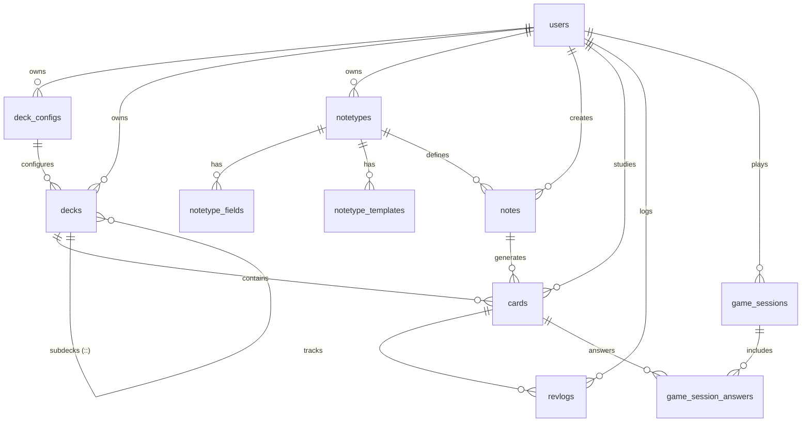

# Thiết Kế Cơ Sở Dữ Liệu PostgreSQL (Database Schema & Architecture)

## 1. Giới thiệu
Cơ sở dữ liệu của dự án sử dụng hệ quản trị **PostgreSQL 16**. Kiến trúc được thiết kế theo hướng **Multi-tenant Logical Isolation** (Phân tách logic đa người dùng), đảm bảo mỗi tài khoản người dùng chỉ truy cập được dữ liệu thuộc quyền sở hữu của chính mình thông qua trường khóa ngoại `user_id` trên mọi bảng thực thể chính.

---

## 2. Sơ đồ quan hệ thực thể (Entity-Relationship Diagram)



---

## 3. Đặc tả chi tiết các bảng CSDL (Tables Specification)

### 3.1. Bảng `users` (Quản lý người dùng)
Lưu trữ thông tin tài khoản đăng nhập (qua Google OAuth 2.0 hoặc tài khoản nội bộ), điểm XP và chuỗi học tập (Streak).

| Tên Cột | Kiểu Dữ Liệu | Ràng Buộc | Mô Tả |
| :--- | :--- | :--- | :--- |
| `id` | UUID | PRIMARY KEY, DEFAULT gen_random_uuid() | Định danh duy nhất người dùng |
| `email` | VARCHAR(255) | UNIQUE, NOT NULL | Địa chỉ email người dùng |
| `google_id` | VARCHAR(255) | UNIQUE, NULLABLE | ID định danh từ tài khoản Google |
| `display_name` | VARCHAR(255) | NOT NULL | Tên hiển thị người dùng |
| `avatar_url` | TEXT | NULLABLE | Đường dẫn ảnh đại diện |
| `role` | VARCHAR(50) | NOT NULL, DEFAULT 'user' | Vai trò ('user', 'admin') |
| `xp` | INTEGER | NOT NULL, DEFAULT 0 | Tổng điểm kinh nghiệm tích lũy |
| `streak_days` | INTEGER | NOT NULL, DEFAULT 0 | Số ngày học liên tục hiện tại |
| `last_study_date` | DATE | NULLABLE | Ngày học gần nhất để kiểm tra streak |
| `created_at` | TIMESTAMPTZ | NOT NULL, DEFAULT NOW() | Thời gian tạo tài khoản |
| `updated_at` | TIMESTAMPTZ | NOT NULL, DEFAULT NOW() | Thời gian cập nhật gần nhất |

---

### 3.2. Bảng `deck_configs` (Cấu hình bộ thẻ)
Lưu trữ các tham số của thuật toán lặp lại ngắt quãng (SM-2 và FSRS).

| Tên Cột | Kiểu Dữ Liệu | Ràng Buộc | Mô Tả |
| :--- | :--- | :--- | :--- |
| `id` | BIGSERIAL | PRIMARY KEY | Định danh cấu hình |
| `user_id` | UUID | FK -> users.id, ON DELETE CASCADE | Chủ sở hữu cấu hình |
| `name` | VARCHAR(255) | NOT NULL | Tên bộ cấu hình (vd: 'Default', 'Japanese JLPT') |
| `new_per_day` | INTEGER | NOT NULL, DEFAULT 20 | Giới hạn số thẻ mới tối đa mỗi ngày |
| `reviews_per_day`| INTEGER | NOT NULL, DEFAULT 200 | Giới hạn số thẻ ôn tập tối đa mỗi ngày |
| `learning_steps` | JSONB | NOT NULL, DEFAULT '[1, 10]' | Các bước học ban đầu (phút) |
| `relearning_steps`| JSONB | NOT NULL, DEFAULT '[10]' | Các bước học lại khi quên (phút) |
| `graduating_interval`| INTEGER| NOT NULL, DEFAULT 1 | Khoảng cách tốt nghiệp (ngày) |
| `easy_interval` | INTEGER | NOT NULL, DEFAULT 4 | Khoảng cách thẻ dễ (ngày) |
| `starting_ease` | INTEGER | NOT NULL, DEFAULT 2500 | Hệ số dễ khởi điểm (250%) |
| `fsrs_enabled` | BOOLEAN | NOT NULL, DEFAULT FALSE | Bật/tắt thuật toán FSRS |
| `fsrs_params` | JSONB | NULLABLE | 19 vector trọng số của FSRS |
| `desired_retention`| FLOAT | NOT NULL, DEFAULT 0.90 | Tỷ lệ duy trì mong muốn (80% - 97%) |
| `leech_threshold` | INTEGER | NOT NULL, DEFAULT 8 | Ngưỡng số lần quên để coi là thẻ khó |
| `leech_action` | VARCHAR(20) | NOT NULL, DEFAULT 'tag' | Hành vi khi đạt ngưỡng ('tag', 'suspend') |

---

### 3.3. Bảng `decks` (Bộ thẻ học)
Lưu trữ danh sách bộ thẻ và hỗ trợ phân cấp đa tầng (ví dụ: `Tiếng Nhật Tổng Hợp::01. Từ vựng::N3`).

| Tên Cột | Kiểu Dữ Liệu | Ràng Buộc | Mô Tả |
| :--- | :--- | :--- | :--- |
| `id` | BIGINT | PRIMARY KEY | ID bộ thẻ (giữ nguyên ID từ Anki hoặc tự sinh) |
| `user_id` | UUID | FK -> users.id, ON DELETE CASCADE | Người sở hữu bộ thẻ |
| `config_id` | BIGINT | FK -> deck_configs.id, NULLABLE | Cấu hình áp dụng cho bộ thẻ |
| `name` | VARCHAR(500) | NOT NULL | Tên đầy đủ gồm cả chuỗi cha con `::` |
| `description` | TEXT | NULLABLE | Mô tả chi tiết bộ thẻ |
| `is_collapsed` | BOOLEAN | NOT NULL, DEFAULT FALSE | Trạng thái thu gọn/mở rộng trên giao diện cây |
| `created_at` | TIMESTAMPTZ | NOT NULL, DEFAULT NOW() | Thời gian tạo |
| `updated_at` | TIMESTAMPTZ | NOT NULL, DEFAULT NOW() | Thời gian cập nhật |

---

### 3.4. Bảng `notetypes` (Mẫu thẻ / Models)
Lưu trữ thông tin loại thẻ (ví dụ: Basic, Cloze, Mazii Vocab Master, Mazii Kanji Master).

| Tên Cột | Kiểu Dữ Liệu | Ràng Buộc | Mô Tả |
| :--- | :--- | :--- | :--- |
| `id` | BIGINT | PRIMARY KEY | ID mẫu thẻ |
| `user_id` | UUID | FK -> users.id, ON DELETE CASCADE | Người sở hữu mẫu thẻ |
| `name` | VARCHAR(255) | NOT NULL | Tên mẫu thẻ |
| `css` | TEXT | NOT NULL, DEFAULT '' | Mã CSS định dạng giao diện thẻ |
| `latex_pre` | TEXT | NULLABLE | Phần tiền tố LaTeX |
| `latex_post` | TEXT | NULLABLE | Phần hậu tố LaTeX |

---

### 3.5. Bảng `notetype_fields` (Trường dữ liệu của mẫu thẻ)
Định nghĩa danh sách các trường (ví dụ: `Expression`, `Reading`, `Meaning`, `Level`, `Audio`, `Examples`).

| Tên Cột | Kiểu Dữ Liệu | Ràng Buộc | Mô Tả |
| :--- | :--- | :--- | :--- |
| `id` | BIGSERIAL | PRIMARY KEY | Định danh trường |
| `notetype_id` | BIGINT | FK -> notetypes.id, ON DELETE CASCADE | Mẫu thẻ sở hữu |
| `name` | VARCHAR(255) | NOT NULL | Tên trường |
| `ord` | INTEGER | NOT NULL | Thứ tự hiển thị (0, 1, 2, ...) |

---

### 3.6. Bảng `notetype_templates` (Mẫu thẻ hiển thị Front/Back)
Quy định cách thức hiển thị mặt trước và mặt sau của thẻ.

| Tên Cột | Kiểu Dữ Liệu | Ràng Buộc | Mô Tả |
| :--- | :--- | :--- | :--- |
| `id` | BIGSERIAL | PRIMARY KEY | Định danh template |
| `notetype_id` | BIGINT | FK -> notetypes.id, ON DELETE CASCADE | Mẫu thẻ sở hữu |
| `name` | VARCHAR(255) | NOT NULL | Tên template (vd: 'Card 1', 'Vocab Card') |
| `ord` | INTEGER | NOT NULL | Chỉ số template (0, 1, ...) |
| `qfmt` | TEXT | NOT NULL | Cú pháp mẫu câu hỏi mặt trước (Front) |
| `afmt` | TEXT | NOT NULL | Cú pháp mẫu câu trả lời mặt sau (Back) |

---

### 3.7. Bảng `notes` (Ghi chú gốc)
Lưu nội dung thực tế của kiến thức được nạp vào.

| Tên Cột | Kiểu Dữ Liệu | Ràng Buộc | Mô Tả |
| :--- | :--- | :--- | :--- |
| `id` | BIGINT | PRIMARY KEY | ID ghi chú |
| `user_id` | UUID | FK -> users.id, ON DELETE CASCADE | Người sở hữu ghi chú |
| `notetype_id` | BIGINT | FK -> notetypes.id, ON DELETE RESTRICT| Loại mẫu thẻ sử dụng |
| `guid` | VARCHAR(255) | NOT NULL | Mã định danh toàn cầu duy nhất |
| `fields` | JSONB | NOT NULL | Mảng giá trị của các trường theo thứ tự `ord` |
| `tags` | JSONB / Array | NOT NULL, DEFAULT '[]' | Mảng các nhãn phân loại (danh sách chuỗi) |
| `created_at` | TIMESTAMPTZ | NOT NULL, DEFAULT NOW() | Thời gian tạo |
| `updated_at` | TIMESTAMPTZ | NOT NULL, DEFAULT NOW() | Thời gian sửa đổi |

---

### 3.8. Bảng `cards` (Thẻ flashcard thực tế)
Mỗi ghi chú (Note) có thể sinh ra một hoặc nhiều thẻ (Card) tương ứng với số lượng template.

| Tên Cột | Kiểu Dữ Liệu | Ràng Buộc | Mô Tả |
| :--- | :--- | :--- | :--- |
| `id` | BIGINT | PRIMARY KEY | ID thẻ |
| `user_id` | UUID / VARCHAR(36) | FK -> users.id, ON DELETE CASCADE | Người sở hữu thẻ |
| `note_id` | BIGINT | FK -> notes.id, ON DELETE CASCADE | Ghi chú gốc tạo ra thẻ |
| `deck_id` | BIGINT | FK -> decks.id, ON DELETE CASCADE | Bộ thẻ chứa thẻ hiện tại |
| `ord` | INTEGER | NOT NULL | Thứ tự template tương ứng trong mẫu thẻ |
| `type` | SMALLINT | NOT NULL, DEFAULT 0 | 0=New, 1=Learning, 2=Review, 3=Relearning |
| `queue` | SMALLINT | NOT NULL, DEFAULT 0 | 0=New, 1=Learn, 2=Review, 3=Day-learn, -1=Suspended, -2=Buried |
| `due` | BIGINT | NOT NULL, DEFAULT 0 | Ngày hoặc timestamp đến hạn học |
| `ivl` | INTEGER | NOT NULL, DEFAULT 0 | Khoảng cách ôn tập hiện tại (ngày hoặc phút) |
| `factor` | INTEGER | NOT NULL, DEFAULT 2500 | Hệ số dễ (Ease Factor, 2500 = 250%) |
| `reps` | INTEGER | NOT NULL, DEFAULT 0 | Tổng số lần đã lật ôn tập thẻ |
| `lapses` | INTEGER | NOT NULL, DEFAULT 0 | Tổng số lần trả lời sai / quên |
| `left` | INTEGER | NOT NULL, DEFAULT 0 | Các bước học còn lại trong chu kỳ học |
| `flags` | SMALLINT | NOT NULL, DEFAULT 0 | Cờ màu đánh dấu thẻ (0=Không cờ, 1=Đỏ, 2=Cam, 3=Lục, 4=Lam,...) |
| `fsrs_stability`| FLOAT | NULLABLE | Độ ổn định trí nhớ theo FSRS (ngày) |
| `fsrs_difficulty`| FLOAT | NULLABLE | Độ khó nội tại theo FSRS (1.0 - 10.0) |
| `created_at` | TIMESTAMPTZ | NOT NULL, DEFAULT NOW() | Thời gian tạo thẻ |
| `updated_at` | TIMESTAMPTZ | NOT NULL, DEFAULT NOW() | Thời gian cập nhật gần nhất |

---

### 3.9. Bảng `revlogs` (Nhật ký ôn tập thẻ)
Ghi nhận mọi lần tương tác đánh giá thẻ hoặc trả lời trong Game để vẽ biểu đồ và phân tích trí nhớ.

| Tên Cột | Kiểu Dữ Liệu | Ràng Buộc | Mô Tả |
| :--- | :--- | :--- | :--- |
| `id` | BIGSERIAL | PRIMARY KEY | Định danh bản ghi nhật ký |
| `user_id` | UUID | FK -> users.id, ON DELETE CASCADE | Người thực hiện ôn |
| `card_id` | BIGINT | FK -> cards.id, ON DELETE CASCADE | Thẻ được ôn tập |
| `rating` | SMALLINT | NOT NULL | Đánh giá (1=Again, 2=Hard, 3=Good, 4=Easy) |
| `new_ivl` | INTEGER | NOT NULL | Khoảng cách mới sau khi đánh giá |
| `last_ivl` | INTEGER | NOT NULL | Khoảng cách trước đó |
| `factor` | INTEGER | NOT NULL | Hệ số dễ sau khi đánh giá |
| `time_taken_ms` | INTEGER | NOT NULL, DEFAULT 0 | Thời gian suy nghĩ trả lời (mili-giây) |
| `review_type` | SMALLINT | NOT NULL, DEFAULT 1 | 0=Learn, 1=Review, 2=Relearn, 3=Filtered, 4=Game Quiz |
| `created_at` | TIMESTAMPTZ | NOT NULL, DEFAULT NOW() | Thời điểm ghi nhận ôn tập |

---

### 3.10. Bảng `game_sessions` & `game_session_answers` (Lịch sử Game)

#### Bảng `game_sessions`:
- `id`: UUID (Primary Key)
- `user_id`: UUID (FK -> users.id, ON DELETE CASCADE)
- `deck_id`: BIGINT (FK -> decks.id, ON DELETE CASCADE)
- `game_type`: VARCHAR(50) (DEFAULT '4-option-quiz')
- `total_questions`: INTEGER
- `correct_count`: INTEGER
- `score`: INTEGER
- `xp_earned`: INTEGER
- `duration_seconds`: INTEGER
- `created_at`: TIMESTAMPTZ

#### Bảng `game_session_answers`:
- `id`: BIGSERIAL (Primary Key)
- `session_id`: UUID (FK -> game_sessions.id, ON DELETE CASCADE)
- `card_id`: BIGINT (FK -> cards.id, ON DELETE CASCADE)
- `user_answer`: TEXT
- `is_correct`: BOOLEAN
- `response_time_ms`: INTEGER

---

## 4. Tối ưu hóa Chỉ Mục (Indexes Strategy)

Để đảm bảo hiệu năng truy vấn tức thì (< 50ms) ngay cả khi tài khoản người dùng có 100,000+ thẻ:

```sql
-- 1. Index tìm thẻ cần học theo thứ tự hàng đợi và ngày đến hạn
CREATE INDEX idx_cards_study_queue ON cards (user_id, deck_id, queue, due);

-- 2. Index liên kết ghi chú và loại mẫu thẻ
CREATE INDEX idx_notes_user_notetype ON notes (user_id, notetype_id);

-- 3. Index tìm kiếm theo Tags trên mảng JSONB/Array
CREATE INDEX idx_notes_tags ON notes USING GIN (tags);

-- 4. Index lịch sử ôn tập theo người dùng và thời gian (dùng cho thống kê biểu đồ)
CREATE INDEX idx_revlogs_user_date ON revlogs (user_id, created_at);

-- 5. Index tìm thẻ theo Note ID (để cập nhật thẻ khi sửa ghi chú)
CREATE INDEX idx_cards_note_id ON cards (note_id);
```
