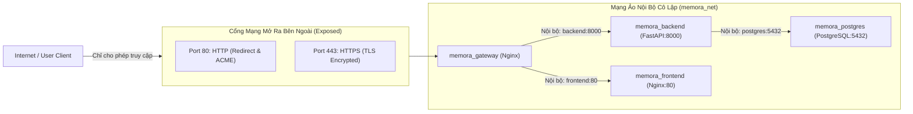

# Hướng Dẫn Triển Khai & Vận Hành Hệ Thống (Deployment & Operations Guide)

## 1. Giới thiệu tổng quan
Tài liệu này cung cấp hướng dẫn toàn diện từ A-Z để triển khai, cấu hình, vận hành và cập nhật hệ thống **Memora** (Anki Core & Gamified Spaced Repetition Platform). Hệ thống được thiết kế theo mô hình **Tinh Gọn (Lean Architecture)** và **Cô Lập Mạng Tuyệt Đối (Strict Network Isolation)**:
- **Chỉ mở cổng đối ngoại 80 và 443**: Toàn bộ dịch vụ nội bộ (CSDL PostgreSQL, API Backend FastAPI, Web Frontend Vue) đều nằm trong mạng ảo nội bộ, không expose cổng ra internet.
- **Phân định rõ hai kịch bản triển khai**:
  1. **Môi trường máy tính cá nhân (Local Development / Testing)**: Chạy đơn giản bằng `http://localhost`, thử nghiệm nhanh bằng Dev Login 1-click mà không cần tài khoản Google Cloud hay chứng chỉ phức tạp.
  2. **Môi trường máy chủ thực tế (Production Server)**: Chạy trên máy chủ Linux (Ubuntu/Debian) với địa chỉ **IPv4 cố định (Static Public IP)**, tên miền qua DuckDNS, chứng chỉ SSL chính thức tự động từ Let's Encrypt (Certbot ACME Webroot) và xác thực bảo mật Google OAuth 2.0.

---

## 2. Bảng So Sánh Cấu Hình: Môi Trường DEV vs PRODUCTION

| Tiêu chí | Chế độ Phát triển (DEV / Local) | Chế độ Thực tế (PRODUCTION / Linux VPS) |
| :--- | :--- | :--- |
| **Hệ thống chạy** | Máy tính cá nhân (Windows / macOS / Linux) | VPS Linux (Ubuntu 22.04 LTS / Debian 12) |
| **Địa chỉ IP** | Cục bộ: `127.0.0.1` hoặc mạng LAN nội bộ | IPv4 Public cố định từ nhà cung cấp VPS |
| **Tên miền truy cập** | `localhost` hoặc `127.0.0.1` | `<your-subdomain>.duckdns.org` (Gán cố định 1 lần) |
| **Chứng chỉ SSL / HTTPS** | Chứng chỉ tự ký (Self-signed) hoặc HTTP cổng 80 | Chứng chỉ CA chính thức từ **Let's Encrypt** qua Certbot |
| **`ENVIRONMENT`** | `development` | `production` |
| **`ENABLE_DEV_LOGIN`** | `true` (Cho phép đăng nhập mock 1-click & đổi user) | `false` (Bắt buộc xác thực an toàn qua Google OAuth) |
| **Google OAuth Client** | Origins: `http://localhost`, `https://localhost` | Origins: `https://<your-subdomain>.duckdns.org` |
| **`SECRET_KEY`** | Chuỗi ngẫu nhiên mặc định | Chuỗi 64 ký tự hex ngẫu nhiên bảo mật cao |
| **Mở cổng Firewall** | Chỉ lắng nghe cục bộ | Mở tường lửa (UFW) cho cổng `80`, `443`, và `22` (SSH) |
| **Cổng mạng Container** | Chỉ Gateway map `80` và `443` | Chỉ Gateway map `80` và `443`. Cấm expose cổng DB/API |
| **Volume lưu trữ** | `postgres_data`, `media_storage` | `postgres_data`, `media_storage` (kèm backup định kỳ) |

---

## 3. Khởi Tạo Hệ Thống Trên Máy Tính Cá Nhân (Local PC Setup)

### 3.1. Chạy nhanh qua Docker Compose (Khuyến nghị)
1. **Chuẩn bị file biến môi trường `.env`**:
   Sao chép từ `.env.example`:
   ```bash
   cp .env.example .env
   ```
   Thiết lập các giá trị tối thiểu cho Local:
   ```ini
   ENVIRONMENT=development
   ENABLE_DEV_LOGIN=true
   POSTGRES_DB=memora_db
   POSTGRES_USER=memora_user
   POSTGRES_PASSWORD=memora_secret_password
   SECRET_KEY=e83b4c1945a0b41f89c6d3215f76b1049c32f8b5a120ef7289d0c64819a3ef21
   ```

2. **Tạo chứng chỉ SSL tự ký cho `localhost` (Tùy chọn nếu muốn test HTTPS)**:
   - **Trên Windows (PowerShell)**:
     ```powershell
     python -c "from cryptography import x509; from cryptography.x509.oid import NameOID; from cryptography.hazmat.primitives import hashes, serialization; from cryptography.hazmat.primitives.asymmetric import rsa; import datetime, os; key = rsa.generate_private_key(65537, 2048); cert = x509.CertificateBuilder().subject_name(x509.Name([x509.NameAttribute(NameOID.COMMON_NAME, 'localhost')])).issuer_name(x509.Name([x509.NameAttribute(NameOID.COMMON_NAME, 'localhost')])).public_key(key.public_key()).serial_number(x509.random_serial_number()).not_valid_before(datetime.datetime.now(datetime.timezone.utc)).not_valid_after(datetime.datetime.now(datetime.timezone.utc) + datetime.timedelta(days=365)).sign(key, hashes.SHA256()); os.makedirs('nginx/ssl/live', exist_ok=True); open('nginx/ssl/live/privkey.pem', 'wb').write(key.private_bytes(serialization.Encoding.PEM, serialization.PrivateFormat.TraditionalOpenSSL, serialization.NoEncryption())); open('nginx/ssl/live/fullchain.pem', 'wb').write(cert.public_bytes(serialization.Encoding.PEM))"
     ```
   - **Trên Linux / macOS (Bash)**:
     ```bash
     mkdir -p nginx/ssl/live
     openssl req -x509 -nodes -days 365 -newkey rsa:2048 \
       -keyout nginx/ssl/live/privkey.pem \
       -out nginx/ssl/live/fullchain.pem \
       -subj "/CN=localhost"
     ```

3. **Khởi chạy hệ thống**:
   ```bash
   docker compose up -d
   ```

4. **Truy cập ứng dụng**:
   - Web App: `http://localhost` (hoặc `https://localhost`)
   - Bấm nút **"Dev Login (1-Click)"** trên màn hình Đăng nhập để vào ngay trang chính với tài khoản thử nghiệm.

---

## 4. Khởi Tạo Hệ Thống Trên Server Linux Cố Định IPv4 (Production VPS Setup)

Áp dụng cho các nhà cung cấp Cloud/VPS (DigitalOcean, Linode, AWS EC2, Google Cloud Compute, Vultr, Hetzner, Vietnix,...).

### 4.1. Cài đặt Docker & Docker Compose trên Ubuntu 22.04 LTS
Đăng nhập SSH vào server với quyền `root` hoặc `sudo`:
```bash
# 1. Cập nhật hệ thống
sudo apt update && sudo apt upgrade -y

# 2. Cài đặt các gói tiện ích
sudo apt install -y curl git ufw ca-certificates gnupg lsb-release

# 3. Thêm GPG key và repo chính thức của Docker
sudo install -m 0755 -d /etc/apt/keyrings
curl -fsSL https://download.docker.com/linux/ubuntu/gpg | sudo gpg --dearmor -o /etc/apt/keyrings/docker.gpg
sudo chmod a+r /etc/apt/keyrings/docker.gpg

echo \
  "deb [arch="$(dpkg --print-architecture)" signed-by=/etc/apt/keyrings/docker.gpg] https://download.docker.com/linux/ubuntu \
  "$(. /etc/os-release && echo "$VERSION_CODENAME")" stable" | \
  sudo tee /etc/apt/sources.list.d/docker.list > /dev/null

sudo apt update
sudo apt install -y docker-ce docker-ce-cli containerd.io docker-buildx-plugin docker-compose-plugin

# 4. Kích hoạt Docker chạy cùng hệ thống
sudo systemctl enable --now docker
```

### 4.2. Cấu hình Tường lửa (UFW Firewall)
Mở các cổng cần thiết và kích hoạt tường lửa:
```bash
sudo ufw default deny incoming
sudo ufw default allow outgoing
sudo ufw allow 22/tcp    # Cổng SSH quản trị
sudo ufw allow 80/tcp    # Cổng HTTP (ACME challenge & HTTP redirect)
sudo ufw allow 443/tcp   # Cổng HTTPS bảo mật
sudo ufw enable
```

### 4.3. Cấu hình Tên Miền DuckDNS Với IPv4 Cố Định
Do server của bạn sử dụng **IPv4 cố định**, việc cấu hình DuckDNS diễn ra trực tiếp một lần duy nhất mà **hoàn toàn không cần chạy container cập nhật IP**:
1. Truy cập [https://www.duckdns.org](https://www.duckdns.org), đăng nhập tài khoản.
2. Tại mục **domains**, tạo một subdomain mới (ví dụ: `myankicloud`).
3. Điền địa chỉ **IPv4 Public cố định** của VPS vào ô IP của subdomain đó và bấm **update ip**.
4. Kiểm tra phân giải tên miền từ máy cá nhân:
   ```bash
   nslookup myankicloud.duckdns.org
   ```
   Khi kết quả trả về đúng địa chỉ IPv4 của VPS là hoàn tất.

### 4.4. Tải Mã Nguồn & Cấu hình `.env` Production
```bash
# Clone mã nguồn vào server
cd /opt
sudo git clone <your-repository-url> memora
cd memora

# Tạo file .env
sudo cp .env.example .env
sudo nano .env
```

Điền các thông số Production:
```ini
ENVIRONMENT=production
ENABLE_DEV_LOGIN=false

DUCKDNS_DOMAIN=myankicloud

POSTGRES_DB=memora_db
POSTGRES_USER=memora_user
POSTGRES_PASSWORD=YourExtremelyStrongRandomPasswordHere!

# Tạo Secret Key 64-hex ngẫu nhiên: openssl rand -hex 32
SECRET_KEY=94c8b21...your_generated_hex_key...

GOOGLE_CLIENT_ID=your-client-id.apps.googleusercontent.com
GOOGLE_CLIENT_SECRET=your-client-secret
```

### 4.5. Cấp phát Chứng Chỉ SSL Let's Encrypt Tự Động Qua Certbot (Webroot)
Hệ thống sử dụng cơ chế chia sẻ thư mục webroot giữa Nginx Gateway và Certbot:
```bash
# 1. Tạo thư mục chứa chứng chỉ và thư mục xác thực ACME
mkdir -p nginx/ssl nginx/certbot-www

# 2. Khởi chạy Gateway để lắng nghe cổng 80 và phục vụ ACME challenge
docker compose up -d gateway

# 3. Yêu cầu cấp chứng chỉ Let's Encrypt bằng Certbot một lần (One-shot)
docker run -it --rm --name certbot \
  -v "$(pwd)/nginx/ssl:/etc/letsencrypt" \
  -v "$(pwd)/nginx/certbot-www:/var/www/certbot" \
  certbot/certbot certonly --webroot \
  --webroot-path=/var/www/certbot \
  -d ${DUCKDNS_DOMAIN}.duckdns.org \
  --email admin@${DUCKDNS_DOMAIN}.duckdns.org \
  --agree-tos --no-eff-email

# 4. Tạo đường dẫn symbolic hoặc sao chép cert vào nginx/ssl/live
# (Nếu Certbot lưu tại nginx/ssl/live/<domain>/, liên kết tới nginx/ssl/live/fullchain.pem)
cd nginx/ssl/live
ln -sf ${DUCKDNS_DOMAIN}.duckdns.org/fullchain.pem fullchain.pem
ln -sf ${DUCKDNS_DOMAIN}.duckdns.org/privkey.pem privkey.pem
cd ../../

# 5. Khởi chạy toàn bộ hệ thống
docker compose up -d --build
```

---

## 5. Hướng Dẫn Cấu Hình Google Cloud OAuth 2.0

Để tính năng đăng nhập Google hoạt động chính xác trên cả Local và Production:

1. Truy cập [Google Cloud Console](https://console.cloud.google.com/).
2. Tạo một Project mới (ví dụ: `Memora Web Platform`).
3. Vào **APIs & Services** $\rightarrow$ **OAuth consent screen**:
   - Chọn User Type: **External**.
   - Điền App Name (`Memora`), User support email, Developer contact email.
   - Bấm Save and Continue.
4. Vào **APIs & Services** $\rightarrow$ **Credentials**:
   - Bấm **Create Credentials** $\rightarrow$ **OAuth client ID**.
   - Application type: **Web application**.
   - Name: `Memora Web Client`.
5. **Cấu hình Authorized JavaScript origins**:
   - `http://localhost`
   - `https://localhost`
   - `https://myankicloud.duckdns.org` (Tên miền thực tế của bạn)
6. **Cấu hình Authorized redirect URIs**:
   - `http://localhost/login`
   - `https://localhost/login`
   - `https://myankicloud.duckdns.org/login`
7. Bấm **Create** và sao chép **Client ID** vào file `.env` (`GOOGLE_CLIENT_ID=...`).

---

## 6. Quy Trình Cập Nhật Hệ Thống An Toàn (Safe Update Procedure)

Khi cập nhật tính năng mới hoặc bản vá, áp dụng quy trình 5 bước sau để đảm bảo an toàn tuyệt đối cho dữ liệu:

### Bước 1: Sao lưu CSDL PostgreSQL (Backup)
```bash
mkdir -p backups
docker exec -t memora_postgres pg_dump -U memora_user memora_db > backups/backup_$(date +%Y%m%d_%H%M%S).sql
```

### Bước 2: Kéo mã nguồn mới nhất từ Git
```bash
git pull origin main
```

### Bước 3: Áp dụng Migration CSDL (nếu có bổ sung trường)
Ví dụ bổ sung trường `flags` trong Anki:
```bash
docker exec -i memora_postgres psql -U memora_user -d memora_db -c "
  ALTER TABLE cards ADD COLUMN IF NOT EXISTS flags SMALLINT DEFAULT 0 NOT NULL;
"
```

### Bước 4: Rebuild và Tái Tạo Container An Toàn
Luôn sử dụng `--force-recreate` để đảm bảo Docker cập nhật network sandbox mới:
```bash
# 1. Build image mới
docker compose build backend frontend

# 2. Khởi chạy lại container Backend và Frontend
docker compose up -d --force-recreate --no-deps backend frontend

# 3. Tái tạo lại Nginx Gateway để cập nhật upstream cache
docker compose up -d --force-recreate --no-deps gateway
```

### Bước 5: Khôi phục Dữ Liệu (Khi có sự cố)
```bash
cat backups/backup_YYYYMMDD_HHMMSS.sql | docker exec -i memora_postgres psql -U memora_user -d memora_db
```

---

## 7. Chính Sách Cách Ly & Bảo Mật Cổng Mạng (Strict Network Isolation)

Hệ thống tuân thủ nghiêm ngặt nguyên tắc tối thiểu hóa bề mặt tấn công (Minimal Attack Surface):



### Bảng Kiểm Tra Cách Ly Cổng Mạng:
| Container | Cổng dịch vụ | Expose ra ngoài Host? | Trạng thái bảo vệ |
| :--- | :--- | :--- | :--- |
| `memora_gateway` | 80, 443 | **CÓ** (`0.0.0.0:80`, `0.0.0.0:443`) | Điểm tiếp nhận duy nhất, được bảo vệ bởi SSL, Gzip, Header bảo mật |
| `memora_frontend` | 80 | **KHÔNG** (Chỉ trong `memora_net`) | Trình duyệt không thể gọi trực tiếp, bắt buộc qua Gateway |
| `memora_backend` | 8000 | **KHÔNG** (Chỉ trong `memora_net`) | Chống tấn công brute-force trực tiếp vào API |
| `memora_postgres` | 5432 | **KHÔNG** (Chỉ trong `memora_net`) | **Cách ly CSDL tuyệt đối**, ngăn ngừa rò rỉ dữ liệu hoặc quét cổng |

Kiểm tra bằng lệnh:
```bash
docker ps --format "table {{.Names}}\t{{.Ports}}"
```
Chỉ thấy duy nhất `memora_gateway` có ánh xạ `0.0.0.0:80->80/tcp, 0.0.0.0:443->443/tcp`. Các container còn lại chỉ hiển thị cổng nội bộ không có tiền tố `0.0.0.0:`.

---

## 8. Cẩm Nang Xử Lý Sự Cố Thực Tế (Troubleshooting & Incident Recovery)

### Sự Cố 1: Gateway Crash-Loop (`host not found in upstream "memora_frontend"` hoặc `network sandbox not found`)
- **Dấu hiệu**: Container `memora_gateway` liên tục mở rồi tắt sau 5-10 giây (`Restarting (1)`).
- **Nguyên nhân cốt lõi**:
  1. Container `memora_gateway` cũ bị mất network sandbox (namespace mạng trong kernel Linux bị giải phóng sau khi Docker daemon hoặc WSL2 restart).
  2. Container bị cô lập khỏi mạng nội bộ nên không kết nối được tới DNS nội bộ của Docker (`127.0.0.11:53`), khiến Nginx báo lỗi `host not found in upstream`.
- **Cách khắc phục dứt điểm**:
  ```bash
  # Xóa sạch container gateway cũ bị lỗi sandbox
  docker rm -f memora_gateway
  
  # Khởi động lại container gateway để Docker cấp network sandbox mới
  docker compose up -d gateway
  ```

### Sự Cố 2: Cảnh báo `the "listen ... http2" directive is deprecated`
- **Nguyên nhân**: Nginx phiên bản 1.25.1 trở lên đã thay đổi cú pháp HTTP/2.
- **Cách khắc phục**: Mở file `nginx/nginx.conf`, tại khối `server` cổng 443, thay đổi:
  ```nginx
  # Cũ:
  listen 443 ssl http2;
  
  # Mới:
  listen 443 ssl;
  http2 on;
  ```

### Sự Cố 3: Gia hạn chứng chỉ SSL Let's Encrypt (Certbot Renewal)
Chứng chỉ Let's Encrypt có hiệu lực 90 ngày. Để gia hạn tự động:
```bash
docker run --rm --name certbot-renew \
  -v "$(pwd)/nginx/ssl:/etc/letsencrypt" \
  -v "$(pwd)/nginx/certbot-www:/var/www/certbot" \
  certbot/certbot renew --webroot --webroot-path=/var/www/certbot

# Nạp lại cấu hình Nginx sau khi gia hạn
docker exec memora_gateway nginx -s reload
```
Có thể cấu hình cronjob chạy lệnh trên định kỳ vào ngày 1 hàng tháng (`crontab -e`).

---

## 9. Giám Sát & Quản Trị Hệ Thống (Operations & Health Check)

- **Xem trạng thái tất cả container**:
  ```bash
  docker compose ps
  ```
- **Kiểm tra nhật ký thời gian thực (Live Logs)**:
  ```bash
  docker compose logs -f --tail=100 backend
  docker compose logs -f --tail=100 gateway
  ```
- **Kiểm tra mức độ sử dụng tài nguyên (RAM, CPU)**:
  ```bash
  docker stats
  ```
- **Xóa cache và rác Docker cũ**:
  ```bash
  docker image prune -f
  ```
