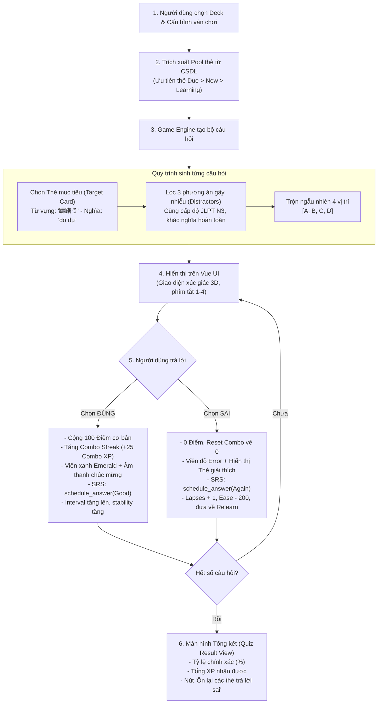

# Thiết Kế Động Cơ Game Học Tập (Quiz Game Engine)

## 1. Mục tiêu và Ý tưởng cốt lõi
Module Game học tập được thiết kế nhằm giải quyết vấn đề "mệt mỏi nhận thức" (Cognitive Fatigue) khi người dùng phải lật hàng trăm thẻ flashcard truyền thống mỗi ngày. 

Thay vì chỉ thụ động nhìn thẻ và tự chấm điểm cho bản thân, người dùng được trải nghiệm cơ chế **Game trắc nghiệm 4 lựa chọn (4-Option Quiz)** với tính phản xạ cao, nhịp độ nhanh (Speed Recall), tích hợp hệ số thưởng chuỗi (Combo Streak) và tích lũy điểm kinh nghiệm (XP).

> [!IMPORTANT]
> **Quy tắc vàng về Spaced Repetition**: 
> Game không tách rời mà được **tích hợp sâu 2 chiều** với thuật toán Anki Core:
> - Người dùng trả lời ĐÚNG trong game $\rightarrow$ Hệ thống tự động ghi nhận thẻ đã thuộc (Tương đương nút **Good** hoặc **Easy** trong Anki), tăng khoảng cách ôn tập (interval) và ghi log vào `revlogs`.
> - Người dùng trả lời SAI trong game $\rightarrow$ Hệ thống tự động ghi nhận thẻ chưa thuộc (Tương đương nút **Again**), tăng số lần quên (`lapses`), giảm hệ số dễ và đưa thẻ vào hàng đợi cần học lại ngay hôm nay.

---

## 2. Kiến trúc và Luồng hoạt động của Game Engine

---

## 3. Thuật toán Sinh Phương Án Gây Nhiễu (Distractor Selection Algorithm)

Để câu hỏi trắc nghiệm có giá trị học thuật cao và chống việc người dùng đoán mò theo độ dài hay ngữ pháp, 3 phương án gây nhiễu (Distractors) được lựa chọn theo nguyên tắc sau:

### 3.1. Đối với Thẻ Từ Vựng (Vocabulary)
1. **Tiêu chuẩn cùng cấp độ (Same JLPT Level / Category)**:
   - Nếu thẻ câu hỏi thuộc cấp độ **JLPT N3**, 3 từ vựng gây nhiễu sẽ được chọn ngẫu nhiên từ danh sách các từ khác cũng thuộc **JLPT N3** trong cùng bộ thẻ.
   - Điều này đảm bảo độ khó cân bằng, từ ngữ có độ phức tạp tương đương nhau.
2. **Loại trừ trùng nghĩa (Semantic Exclusivity)**:
   - Các phương án nhiễu được so khớp chuỗi nghĩa (String Similarity) để tránh trường hợp bốc phải 2 từ đồng nghĩa (Synonyms) gây nhầm lẫn cho người học.

### 3.2. Đối với Thẻ Hán Tự (Kanji)
- Ưu tiên bốc các Hán tự có cùng cách đọc Âm On/Kun hoặc có các bộ thủ (Radicals) tương tự để kiểm tra khả năng phân biệt chữ viết chính xác của người học.

### 3.3. Hỗ trợ Đổi Chiều Câu Hỏi (Question Inversion)
Game hỗ trợ 2 chế độ hiển thị:
- **Chiều xuôi (Front-to-Back)**: Câu hỏi hiển thị Kanji/Từ vựng tiếng Nhật $\rightarrow$ 4 phương án là Nghĩa tiếng Việt.
- **Chiều ngược (Back-to-Front)**: Câu hỏi hiển thị Nghĩa tiếng Việt $\rightarrow$ 4 phương án là Từ vựng/Kanji tiếng Nhật.

---

## 4. Hệ Thống Tính Điểm, Combo và Điểm Kinh Nghiệm (XP)

| Thành Phần | Công Thức Tính | Ý Nghĩa / Mục Đích |
| :--- | :--- | :--- |
| **Điểm cơ bản (Base Score)** | $+100$ điểm / câu đúng | Thưởng cho mỗi đáp án chính xác |
| **Thưởng tốc độ (Speed Bonus)** | $+ \max(0, (15 - t) \times 5)$ | Khuyến khích phản xạ nhanh (trả lời trong vòng 5s nhận tối đa +50 điểm) |
| **Hệ số Combo (Streak Multiplier)** | Combo $C \ge 3 \rightarrow \times 1.2$ Combo $C \ge 5 \rightarrow \times 1.5$ Combo $C \ge 10 \rightarrow \times 2.0$ | Giữ nhịp tập trung và hưng phấn liên tục |
| **Điểm kinh nghiệm (XP)** | $+15$ XP cơ bản $+ (C \times 2)$ Combo XP | Tích lũy vào tài khoản để tăng cấp học giả (Scholar Level) |

---

## 5. Các Chế Độ Chơi (Game Modes)

1. **4-Option Standard Quiz (Mặc định)**:
   - 10 hoặc 20 câu hỏi mỗi phiên.
   - Đồng bộ trạng thái thẻ trực tiếp vào chu kỳ lặp lại ngắt quãng SRS.
2. **Speed Run / Time Attack**:
   - Đếm ngược 10 giây cho mỗi câu hỏi.
   - Hết giờ mà chưa bấm chọn được tính là trả lời Sai (Again).
3. **Practice Sandbox (Luyện tập tự do)**:
   - Dành cho những lúc người dùng muốn chơi giải trí thuần túy hoặc chuẩn bị trước kỳ thi.
   - Không can thiệp vào chu kỳ SRS của thẻ, chỉ cộng điểm kinh nghiệm XP.
4. **Weak Cards Blitz (Luyện thẻ yếu)**:
   - Hệ thống tự động lọc ra danh sách các thẻ có số lần quên cao nhất (`lapses >= 3`) hoặc thẻ đang bị gắn mác Leech để người dùng tập trung giải quyết dứt điểm các lỗ hổng kiến thức.

---

## 6. Thiết Kế Trực Quan & Trải Nghiệm Người Dùng (UX)
Tuân thủ nghiêm ngặt bảng thiết kế `Stitch_mock_UI`:
- 4 ô lựa chọn (A, B, C, D) thiết kế dạng gạch nổi (Tile) với bóng đổ dưới dày 3px (`shadow-[0_3px_0_0_#dae2fd]`), khi bấm lún xuống 2px (`active:translate-y-[2px] active:shadow-none`).
- Hỗ trợ phím tắt số `1`, `2`, `3`, `4` tương ứng với các phím chữ cái `A`, `B`, `C`, `D`.
- Khi trả lời đúng: Ô đáp án chuyển nền xanh ngọc dịu nhẹ (`bg-secondary-fixed/20`), viền xanh đậm `#006c49`, hiển thị badge `CORRECT` và khung bóng đèn giải thích cơ chế nhớ (`Memory Hook`).
- Loại bỏ hoàn toàn các biểu tượng emoji sến súa; toàn bộ icon sử dụng mã SVG chuẩn của **Material Symbols Outlined** (`check`, `close`, `lightbulb`, `bolt`, `verified`).
