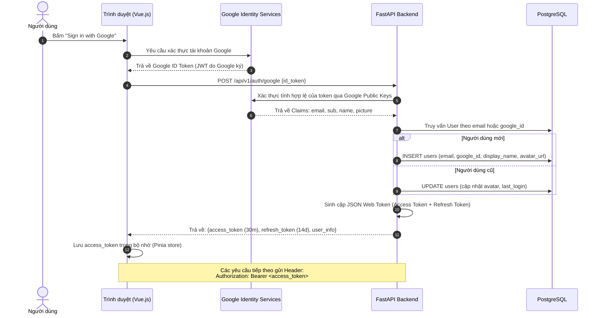

# Thiết Kế Cơ Chế Bảo Mật & Xác Thực (Security & Authentication)

## 1. Giới thiệu tổng quan
Hệ thống được thiết kế với cơ chế bảo mật nhiều lớp (Defense in Depth) nhằm bảo vệ an toàn tuyệt đối cho dữ liệu học tập cá nhân của người dùng, ngăn chặn các cuộc tấn công phổ biến trên môi trường web (OWASP Top 10), và đảm bảo tính cách ly dữ liệu giữa các tài khoản người dùng khác nhau.

---

## 2. Quy Trình Xác Thực Google OAuth 2.0 & Quản Lý Phiên (JWT)



### 2.1. Cấu trúc và Thời hạn của JSON Web Token (JWT)
1. **Access Token**:
   - Thuật toán ký: `HS256` (HMAC SHA-256) hoặc `RS256` với khóa bí mật `SECRET_KEY`.
   - Thời hạn: **30 phút**.
   - Payload chứa: `sub` (user_id), `email`, `role`, `exp` (thời điểm hết hạn), `iat` (thời điểm phát hành).
   - Lưu trữ: Trong biến trạng thái memory của Pinia store trên Client, không lưu vào `localStorage` để chống tấn công đánh cắp token qua XSS.
2. **Refresh Token**:
   - Thời hạn: **14 ngày**.
   - Lưu trữ: Có thể truyền qua HttpOnly Secure Cookie hoặc cơ chế Token Rotation (xoay vòng token) để cấp lại Access Token mới khi hết hạn.

### 2.2. Cơ chế Đăng nhập Môi trường Phát triển (Dev Auth Fallback)
Nhằm giúp lập trình viên có thể phát triển, chạy thử nghiệm cục bộ và viết unit test mà không bị phụ thuộc vào Google Cloud Console:
- Cung cấp endpoint: `POST /api/v1/auth/dev-login`.
- Chỉ hoạt động khi biến môi trường `ENVIRONMENT=development` hoặc `ENABLE_DEV_LOGIN=true`.
- Tự động tạo hoặc đăng nhập tài khoản Developer với đầy đủ quyền hạn.

---

## 3. Phân Tách Dữ Liệu Đa Người Dùng (Multi-Tenant Isolation)

- **Nguyên tắc cốt lõi**: Toàn bộ các bảng CSDL lưu trữ kiến thức (`decks`, `deck_configs`, `notetypes`, `notes`, `cards`, `revlogs`, `game_sessions`) đều bắt buộc có cột `user_id UUID`.
- **Ràng buộc tại tầng truy vấn (Repository Layer)**: Mọi câu lệnh SQL SELECT, INSERT, UPDATE, DELETE đều bắt buộc có điều kiện `WHERE user_id = :current_user_id`.
- Việc lấy `current_user_id` được thực hiện hoàn toàn tự động thông qua cơ chế Dependency Injection của FastAPI:
  ```python
  async def get_current_user(
      token: str = Depends(oauth2_scheme),
      db: AsyncSession = Depends(get_db)
  ) -> User:
      payload = decode_jwt_token(token)
      user_id = payload.get("sub")
      user = await user_repo.get_by_id(db, user_id)
      if not user:
          raise HTTPException(status_code=401, detail="User not found")
      return user
  ```
- Người dùng tuyệt đối không thể truy cập, sửa đổi hay xem thẻ của người dùng khác ngay cả khi biết chính xác ID của bộ thẻ.

---

## 4. Cơ Chế Giới Hạn Tần Suất Yêu Cầu (API Rate Limiting)

Hệ thống tích hợp middleware giới hạn tần suất yêu cầu (dựa trên SlowAPI / Token Bucket) để ngăn chặn tấn công từ chối dịch vụ (DoS) và vét cạn mật khẩu:

| Nhóm Endpoint | Giới Hạn Tần Suất | Hành Vi Khi Vượt Ngưỡng |
| :--- | :--- | :--- |
| **Auth (`/api/v1/auth/*`)** | 10 requests / phút / IP | Trả về `429 Too Many Requests` |
| **Import (`/api/v1/import/*`)** | 5 requests / phút / User | Trả về `429 Too Many Requests` |
| **Study & Game Action** | 120 requests / phút / User | Đảm bảo tốc độ lật thẻ nhanh mà không bị nghẽn |
| **General Read Endpoints** | 200 requests / phút / IP | Phục vụ tải dữ liệu bộ thẻ |

---

## 5. An Toàn Dữ Liệu Tập Tin & Phòng Chống Tấn Công

### 5.1. Phòng Chống Tấn Công Zip-Slip Khi Tải File APKG
Tập tin `.apkg` là file nén ZIP. Kẻ tấn công có thể tạo file zip độc hại chứa các đường dẫn tương đối như `../../../../etc/passwd` để ghi đè file hệ thống.
- **Biện pháp phòng ngừa trong `anki_core.importer`**:
  ```python
  def safe_extract_zip(zip_file: zipfile.ZipFile, target_dir: str):
      for member in zip_file.namelist():
          resolved_path = os.path.realpath(os.path.join(target_dir, member))
          if not resolved_path.startswith(os.path.realpath(target_dir)):
              raise SecurityException(f"Path traversal detected in zip archive: {member}")
  ```

### 5.2. Giới Hạn Kích Thước Tải Lên (Upload File Limit)
- Cấu hình giới hạn kích thước tối đa cho file `.apkg` là **100 MB** tại cả 2 tầng: Nginx (`client_max_body_size 100M;`) và FastAPI Middleware.
- Kiểm tra Magic Bytes (`PK\x03\x04`) để đảm bảo file tải lên thực sự là tập tin ZIP hợp lệ trước khi bắt đầu xử lý.

### 5.3. Vệ Sinh Mã HTML & Phòng Chống XSS (Cross-Site Scripting)
Do các thẻ Anki thường chứa mã HTML (màu sắc, in đậm, bảng biểu), hệ thống kết hợp bảo vệ 2 tầng:
1. **Phía Backend**: Sử dụng thư viện `bleach` để bóc tách các thẻ nguy hiểm (`<script>`, `<iframe onload=...>`, `<object>`, `javascript:`) trước khi lưu vào CSDL.
2. **Phía Frontend**: Sử dụng thư viện `DOMPurify` để khử khuẩn toàn bộ chuỗi HTML template trước khi gán vào thuộc tính `v-html` trong Vue component.

---

## 6. Thiết Lập Tiêu Chuẩn Bảo Mật Tại Nginx Gateway (Security Headers)

Máy chủ Nginx được cấu hình sẵn các HTTP Security Headers theo tiêu chuẩn Mozilla SSL Observatory A+:
- `Strict-Transport-Security: max-age=31536000; includeSubDomains; preload` (Bắt buộc HTTPS).
- `X-Content-Type-Options: nosniff` (Chống MIME-type sniffing).
- `X-Frame-Options: SAMEORIGIN` (Chống Clickjacking).
- `Referrer-Policy: strict-origin-when-cross-origin`.
- `Content-Security-Policy`: Cho phép nạp script từ Google OAuth và Google Fonts an toàn, chặn mọi nguồn script độc hại từ bên ngoài.
